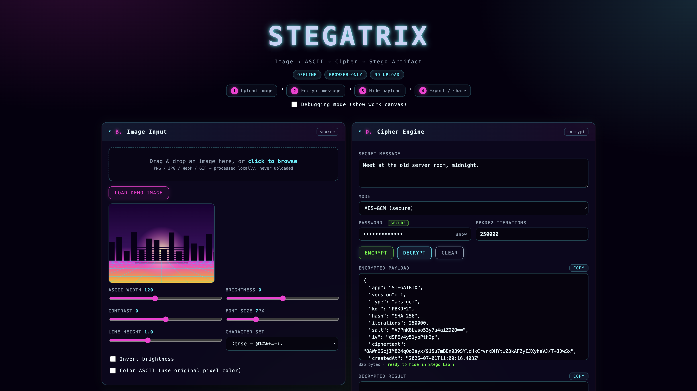

# Stegatrix

Hide an encrypted message inside an image, a text file or a web page, entirely in your browser.

**[Live demo](https://stegatrix.cybrsmr.xyz)** · single HTML file · no build step · no dependencies



## What it does

Stegatrix runs in two directions:

- **Create:** pick an image, encrypt a message, then hide the result in a carrier you can send to someone.
- **Recover:** drop that carrier back in, pull out the payload, and decrypt it.

```
message ──▶ encrypt (AES-256-GCM) ──▶ payload ──▶ carrier ──▶ file you share
file    ──▶ extract payload       ──▶ decrypt  ──▶ message
```

The image also gets converted to ASCII art. That's purely visual: it gives the text and HTML carriers something to look at, and it can't be turned back into the original image.

## Carriers

| Carrier | Where the payload goes | Survives |
|---|---|---|
| **PNG** | Least significant bit of each R, G and B channel, written in pixel order from the top left | Lossless copies only. Re-encoding, resizing, screenshots and most chat apps destroy it. |
| **ASCII text** | A base64 block under the ASCII art, between `---BEGIN/END STEGATRIX PAYLOAD---` markers | Anywhere plain text survives. It's visible, so this one is a container, not a hiding place. |
| **HTML page** | A `<script type="application/json" id="stegatrix-payload">` tag in a standalone page | Anywhere a file survives |
| **Zero-width text** | Bits encoded as U+200B / U+200C after the first word of a cover sentence | Experimental. Many editors, websites and messengers strip these characters. |

## Encryption

**AES-GCM** is the only mode that protects anything:

- The key comes from your password via PBKDF2-HMAC-SHA256 (600,000 iterations by default, per OWASP guidance; imported payloads are capped at 2,000,000 so a crafted file can't freeze the tab), giving a 256-bit AES-GCM key.
- Each message gets a random 16-byte salt and a random 12-byte IV from `crypto.getRandomValues`.
- Everything uses the browser's Web Crypto API. There's no hand-rolled crypto.
- GCM authenticates the ciphertext, so a wrong password or a tampered payload fails instead of returning garbage.

Base64, Caesar, Atbash, Vigenère and XOR are also included, as puzzle modes. They're labelled as insecure in the UI and they are. Use them for CTF-style puzzles, not secrets.

## Threat model

Read this before trusting Stegatrix with anything.

**What it protects:** the *content* of an AES-GCM message, as long as the password is strong. Someone who gets the file can't read the message without the password.

**What it doesn't protect:**

- **The fact that a message exists.** Payloads start with a fixed marker (`STGTRX1` in PNGs) and the AES envelope is plain JSON that includes `"app": "STEGATRIX"`. Anyone who knows to look for Stegatrix can confirm a payload is there. Sequential LSB embedding can also be picked up by standard steganalysis (chi-square, RS analysis). Treat the carriers as a fun container, not covert communication.
- **Metadata.** The envelope stores a `createdAt` timestamp, and the ciphertext length gives away the message length.
- **Weak passwords.** There's no strength check, and PBKDF2 slows down offline guessing without stopping it.
- **A compromised browser or device.** The plaintext and password sit in the page's memory and DOM while you use it.

## Privacy

Encryption, embedding and extraction all happen locally. Your images, messages and passwords are never sent anywhere.

The page loads no third-party scripts, has no analytics and makes no network requests after it loads. The `_headers` CSP enforces that on the hosted demo. Saved as a file, it runs fully offline.

## Run it locally

```bash
git clone https://github.com/atahan99/Stegatrix.git
```

Open `index.html` in any modern browser. Web Crypto works on `file://`, `localhost` and HTTPS, so you don't need a server.

## Project layout

```
index.html        the whole app: markup, styles and script
_headers          security headers for Cloudflare Pages (CSP, frame and referrer policy)
favicon.svg
docs/screenshots/
```

## Known issues

- **Transparent PNGs:** pixels that carry payload bits are made fully opaque, because browsers store canvas pixels with premultiplied alpha and would round the hidden bits away. Transparent areas of the carrier can turn visible.
- **Fingerprinting protection:** browsers that add noise to canvas reads (Brave, or Firefox with `resistFingerprinting`) break PNG embedding and extraction.

## License

No license file yet. All rights reserved until one is added.
