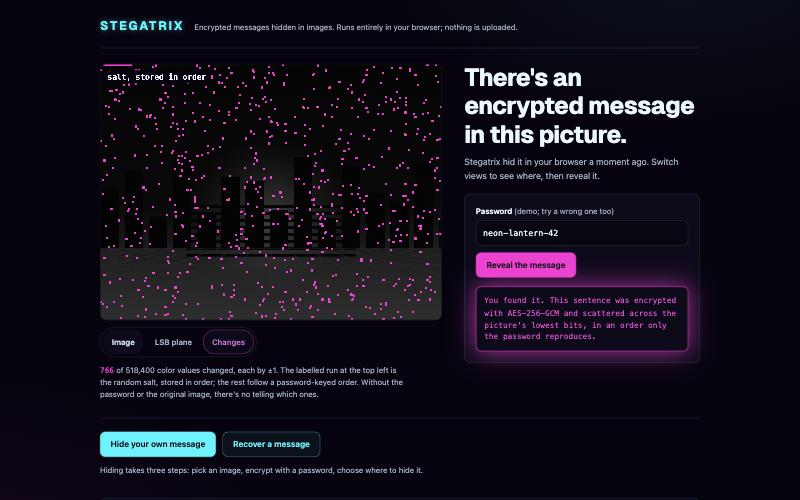
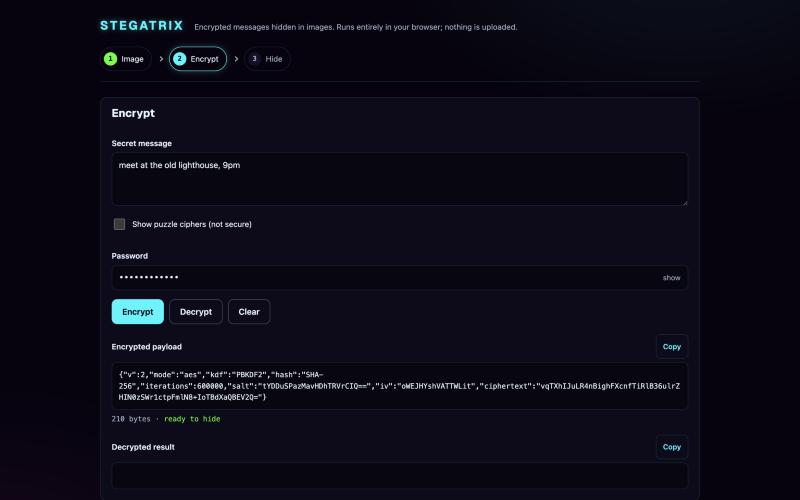
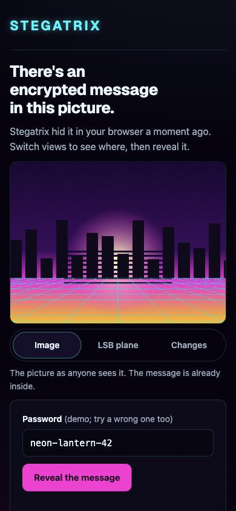

# Stegatrix

Hide an encrypted message inside an image, a text file or a web page, entirely in your browser.

[](https://github.com/atahan99/Stegatrix/actions/workflows/test.yml)

**[Live demo](https://stegatrix.cybrsmr.xyz)** · plain HTML and JS · no build step · no dependencies



The home page hides a real message in a demo image every time it loads. Switch between the image, its LSB plane and the changed pixels, then reveal the message with the password shown on the page.

## What it does

Stegatrix runs in two directions:

- **Create:** pick an image, encrypt a message, then hide the result in a carrier you can send to someone.
- **Recover:** drop that carrier back in, pull out the payload, and decrypt it.

```
message ──▶ encrypt (AES-256-GCM) ──▶ payload ──▶ carrier ──▶ file you share
file    ──▶ extract payload       ──▶ decrypt  ──▶ message
```

The image also gets converted to ASCII art. That's purely visual: it gives the text and HTML carriers something to look at, and it can't be turned back into the original image.

## Carriers

| Carrier | Where the payload goes | Survives |
|---|---|---|
| **PNG** | Least significant bits of the R, G and B channels. AES payloads use a [keyed layout](#keyed-png-format) with no marker; puzzle modes use a public `STGTRX1` marker. | Lossless copies only. Re-encoding, resizing, screenshots and most chat apps destroy it. |
| **ASCII text** | A base64 block under the ASCII art, between `---BEGIN/END STEGATRIX PAYLOAD---` markers | Anywhere plain text survives. It's visible, so this one is a container, not a hiding place. |
| **HTML page** | A `<script type="application/json" id="stegatrix-payload">` tag in a standalone page | Anywhere a file survives |
| **Zero-width text** | Bits encoded as U+200B / U+200C after the first word of a cover sentence | Experimental. Many editors, websites and messengers strip these characters. |

## Encryption

**AES-GCM** is the only mode that protects anything:

- The key comes from your password via PBKDF2-HMAC-SHA256 with 600,000 iterations (OWASP's current guidance), giving a 256-bit AES-GCM key. Imported payloads that ask for more than 2,000,000 iterations are refused, so a crafted file can't freeze the tab.
- Each message gets a random 16-byte salt and a random 12-byte IV from `crypto.getRandomValues`.
- Everything uses the browser's Web Crypto API. There's no hand-rolled crypto.
- GCM authenticates the ciphertext, so a wrong password or a tampered payload fails instead of returning garbage.

Base64, Caesar, Atbash, Vigenère and XOR are also included, as puzzle modes. They're labelled as insecure in the UI and they are. Use them for CTF-style puzzles, not secrets.

Every payload is a small JSON envelope that names its mode (`{"v":2,"mode":"caesar","data":"…"}`), so Recover detects how a message was made. You still supply the key. Older payloads without an envelope still decrypt if you pick the mode by hand.

## Keyed PNG format

AES payloads hidden in a PNG carry no marker, header or plaintext length. Without the password, the image is just an image.

```
slots 0–127   salt (16 random bytes), in pixel order
other slots   [length XOR mask (4)] [IV (12)] [ciphertext + GCM tag]
              in an order only the password reproduces
```

- A *slot* is the least significant bit of one R, G or B channel. Alpha is never used, and transparent images are flattened onto white first, because canvas premultiplies alpha and would erase the bits.
- PBKDF2(password, salt) gives one 256-bit key. It's the AES-GCM key, and HKDF turns it into an AES-CTR key whose keystream does two jobs: it masks the length, and it drives a sparse Fisher-Yates shuffle that picks which slots hold each bit.
- Bits are written with LSB *matching*: when a channel's low bit is wrong, its value steps randomly up or down by 1 rather than having the bit overwritten. Overwriting only swaps values within pairs (2k ↔ 2k+1), and that pair asymmetry is what chi-square, RS and sample-pairs analysis measure.
- Recovering reads the salt, derives the key, reads the 16-byte header from the keyed slots, unmasks the length, then reads and decrypts the rest. A wrong password and an image with nothing hidden fail with the same message.
- Hiding checks that the password opens the encrypted message first, so you can't create a PNG nobody can recover.

## Threat model

Read this before trusting Stegatrix with anything.

**What it protects:** the *content* of an AES-GCM message, as long as the password is strong. Someone who gets the file can't read the message without the password.

**What it doesn't protect:**

- **The fact that a message exists, except in keyed PNGs.** The ASCII, HTML and zero-width carriers are labelled containers, and puzzle-mode PNGs start with `STGTRX1`. Keyed PNGs have no marker and use LSB matching, which defeats the classic pair-based attacks. Histogram-based and machine-learning steganalysis can still detect LSB matching at higher embedding rates, so keep payloads small relative to the image.
- **Message length in text carriers.** Their ciphertext length gives away the message length. Keyed PNGs mask it.
- **Weak passwords.** There's no strength check, and PBKDF2 slows down offline guessing without stopping it.
- **A compromised browser or device.** The plaintext and password sit in the page's memory and DOM while you use it.

## Privacy

Encryption, embedding and extraction all happen locally. Your images, messages and passwords are never sent anywhere.

The page loads no third-party scripts, has no analytics and makes no network requests after it loads. The `_headers` CSP enforces that on the hosted demo. Saved as a file, it runs fully offline.

## Screenshots

| Encrypt step | Phone |
|---|---|
|  |  |

## Run it locally

```bash
git clone https://github.com/atahan99/Stegatrix.git
```

Open `index.html` in any modern browser. It loads `core.js` from the same folder. Web Crypto works on `file://`, `localhost` and HTTPS, so you don't need a server.

## Tests

```bash
node --test
```

Node 20 or newer, no install. The tests round-trip every cipher and carrier, and check wrong passwords, tampered ciphertext, the iteration cap, PNG capacity and alpha handling. CI runs them on every push.

## Project layout

```
index.html        UI: markup, styles and browser glue (canvas, files, wizard, home demo)
core.js           pure cipher and stego functions, shared with the tests
tests/            node --test suite
_headers          security headers for Cloudflare Pages (CSP, frame and referrer policy)
favicon.svg
fonts/            Geist Bold, self-hosted (SIL Open Font License)
docs/screenshots/
```

## Known issues

- **Transparent PNGs** are flattened onto white before hiding, because browsers store canvas pixels with premultiplied alpha and would round the hidden bits away.
- **Older AES messages can't use the keyed PNG.** Messages encrypted before the fixed 600k setting have to be encrypted again (the app says so).
- **Fingerprinting protection:** browsers that add noise to canvas reads (Brave, or Firefox with `resistFingerprinting`) break PNG embedding and extraction.

## License

No license file yet. All rights reserved until one is added.
